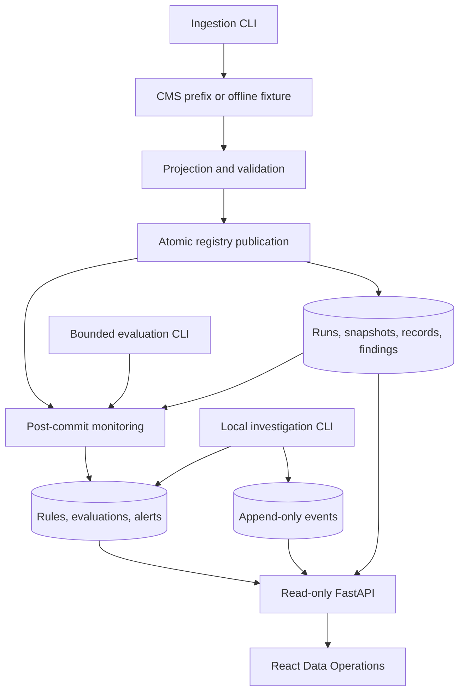

# CareRank 3.1 architecture

The synthetic ranking subsystem remains separate, with its original provider/encounter/score tables and APIs. Monitoring imports only registry models. Real CMS identities are never joined to fictional scores.

Evaluation transaction: lock → load completed run → reuse or register profile → derive metrics → insert all evaluations → insert new alerts and creation events → commit. Any error rolls back the entire transaction. Network retrieval occurs earlier, outside this transaction. A failed monitoring transaction cannot reverse registry publication.

Investigation transaction: lock → verify alert revision → validate transition → update current alert → append one event with next revision → commit. The trigger blocks UPDATE/DELETE of audit events. A privileged database administrator can still change/drop database structures; this is an append-only application audit, not a cryptographically tamper-proof ledger.

PostgreSQL serializes short monitoring writes with advisory lock 721306 and a 10-second lock timeout. Registry publication retains its separate existing lock 721305. There is no ingestion-lock/monitoring-lock nesting. The deliberately simple global monitoring lock limits parallel throughput; no throughput benchmark is claimed. SQLite tests use BEGIN IMMEDIATE as a portability substitute, not proof of PostgreSQL locking behavior.

[Rendered architecture schematic](architecture_3.1.png). This is an explanatory diagram, not a captured application screenshot.
