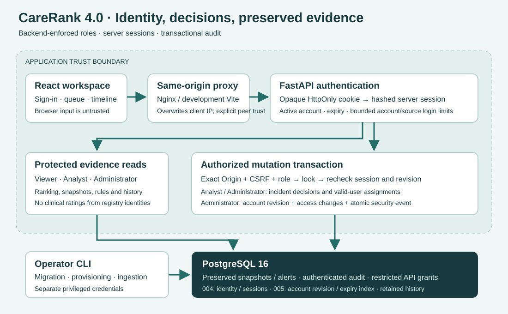
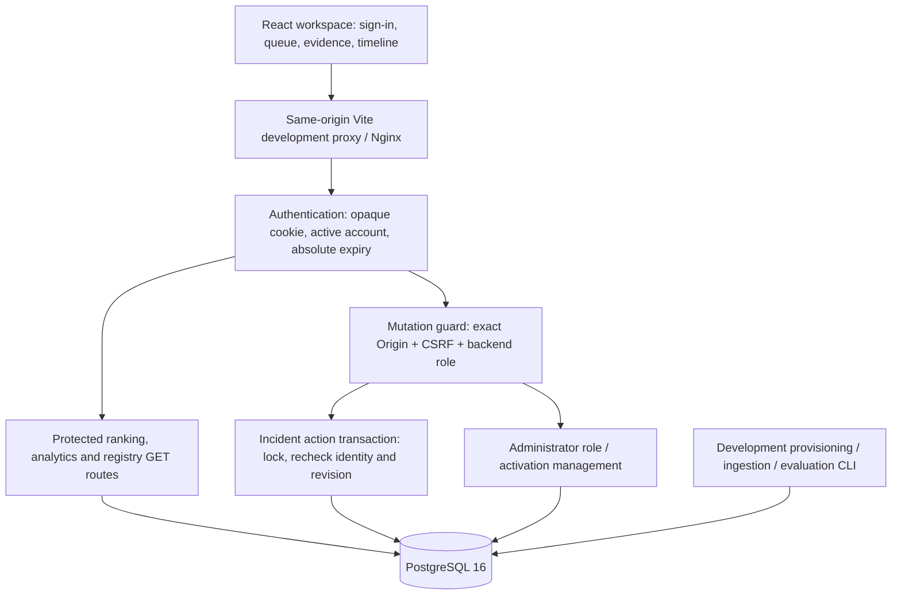
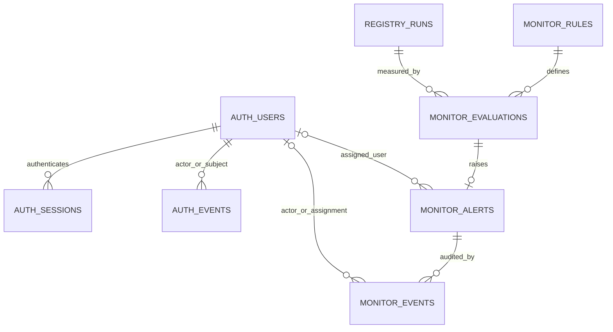

# CareRank 4.0 architecture

CareRank 4.0 extends the merged 3.1 system with authenticated analyst operations. Authentication and incident decisions run in FastAPI; React displays the permissions and server responses. Existing synthetic and registry processing remain separate operator workflows.





## Boundaries and data model

Migration 004 adds `auth_users`, `auth_sessions`, `auth_login_limits` and `auth_events`. Nullable references attach authenticated actor and assignment identity to monitoring history without rewriting legacy events. Existing `assigned_to` text remains readable for historical CLI assignments. New web assignments resolve to active Analyst or Administrator accounts.



Synthetic providers, encounters and scores are not joined to registry clinicians or user accounts. Monitoring retains stable references to the existing run, rule and evaluation that produced the alert. An investigation changes workflow state; it does not rewrite a failed rule result or replace snapshot evidence.

## Request flow

1. The browser submits credentials to the same-origin login endpoint. The server checks the exact allowed origin, persistent login limits, active account and scrypt hash.
2. Successful login generates a fresh random session token. The database stores its SHA-256 digest, account reference, CSRF token and absolute expiry. The browser receives an HttpOnly, SameSite cookie; Secure is enabled by default.
3. `/api/auth/me` restores the user and CSRF token. All application reads resolve the active account and unexpired session server-side.
4. An analyst submits a decision with `expected_revision`, a required note, an optional allowed next state and optional assignment. The server checks CSRF and role, then verifies current authorization/revision under transaction locks.
5. The alert update and append-only event commit together. The event carries authenticated actor ID, timestamp, old/new state, prior/new assignment and decision note. Conflicting revisions are rejected for review, rather than silently retried.
6. Logout deletes the server session. Role/activation changes revoke affected sessions, so changing a frontend variable cannot retain authority.

```mermaid
sequenceDiagram
  actor Analyst
  participant UI as React
  participant API as FastAPI
  participant DB as PostgreSQL
  Analyst->>UI: Decision note + action
  UI->>API: POST action + session cookie + CSRF + expected revision
  API->>API: Origin / session / role validation
  API->>DB: Begin; lock and recheck account/session/alert
  alt Revision is current
    API->>DB: Update alert; append identity-linked audit
    DB-->>API: Commit
    API-->>UI: New revision
    UI-->>Analyst: Reload queue and timeline
  else Revision changed
    API-->>UI: 409 conflict
    UI-->>Analyst: Refresh and review before retry
  end
```

## Runtime and operations

The API uses server-side sessions rather than long-lived browser JWTs, keeping logout and account revocation immediate. Auth writes use READ COMMITTED transactions with explicit locking; analytical reads retain existing repeatable-read behavior. Passwords and raw session tokens never appear in API responses or audit decisions.

Compose remains a localhost development topology, with a non-root API container and an unpublished database port. Its bootstrap seeds only a pristine synthetic lab; explicit pipeline commands remain replacement tools. Provisioning is a development-only CLI; there is no open registration or bootstrap password.

Run migration as the schema owner and a shared-deployment API as a separate restricted database role. See [the threat model and grant example](SECURITY_4.0.md). The published cloud startup scripts are independent environment assets and are not rewritten by this release.

## Verification boundary

Backend tests exercise authorization and database transactions. Component tests exercise login/session and action states. Browser tests exercise the actual same-origin application and use a separate API bound to `carerank_test` for writes. Migration preservation is checked against the existing development database using before/after counts. See [executed evidence](VERIFICATION_4.0.md); diagrams describe the design and are not test results.
