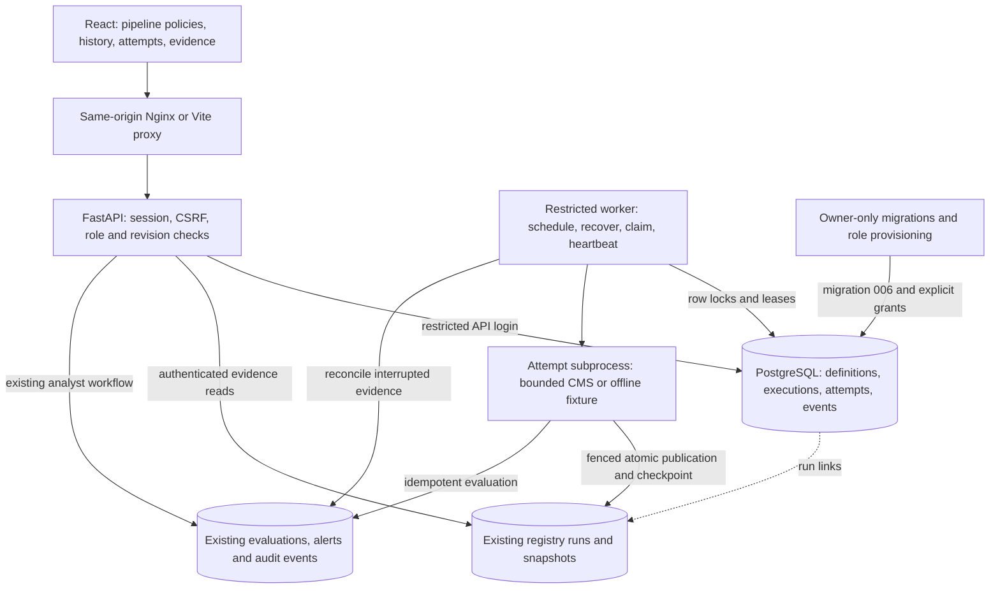

# CareRank 5.0 architecture

CareRank 5.0 adds a PostgreSQL job queue to the existing authenticated React/FastAPI application. Scheduling, claiming and recovery run in a separate worker. HTTP commands persist intent and return; they do not perform source ingestion. Synthetic ranking, registry snapshots, monitoring and analyst investigations keep their existing models.

## Durable state and transaction boundaries

Migration 006 adds four tables; it does not rewrite existing tables or rows:

| Table | Durable responsibility |
| --- | --- |
| `pipeline_definitions` | Administrator policy, revision, interval, enabled state and next due time |
| `pipeline_executions` | Immutable policy copy, idempotency key, state, retry eligibility, active claim, lease/deadline and publication checkpoint |
| `pipeline_attempts` | Attempt number, worker identity, outcome, heartbeat, timestamps, failure code and ingestion-run link |
| `pipeline_events` | Append-only state/decision history, timestamp, authenticated actor where applicable and bounded context |

Definition IDs and execution IDs are distinct from the existing synthetic `pipeline_runs`. Each execution retains its policy even if the definition changes. Events cannot be updated/deleted through the provisioned application roles; the database trigger also rejects ordinary updates/deletes. A privileged database owner remains outside that tamper-resistance boundary.

1. **Schedule:** Workers lock due definitions with `FOR UPDATE SKIP LOCKED`. An occurrence key combines the definition and due timestamp. Enabling makes an occurrence immediately due. Fixed intervals are anchored to the previous due time; missed intervals coalesce into one execution. At 20 active executions, scheduling records `schedule_deferred` and advances the due time. The workspace caps definitions at 100.
2. **Claim:** A transaction locks an eligible definition and execution, increments the attempt number, creates a unique attempt token and records its lease/deadline. A partial unique index permits only one running execution per definition. Other definitions can execute concurrently; oldest ready work is considered first across definitions. Manual submissions use caller UUID keys; repeated submissions return the recorded execution.
3. **Execute:** A supervisor launches one attempt subprocess and renews its lease independently of blocking source I/O. The existing connector validates bounded source data outside the publication transaction. Each attempt has its own ingestion audit record.
4. **Publish:** Existing registry serialization and checksum/scope/policy identity reuse unchanged snapshots. Inside the publication transaction, the worker rechecks the active attempt token, running state, database-clock lease and deadline, then commits the snapshot/run and `published_run_id` checkpoint together. A cancelled or superseded attempt cannot publish.
5. **Evaluate:** Existing monitoring evaluates each terminal ingestion run idempotently. If a process exits after publication, recovery follows the checkpoint and reconciles monitoring without fetching or publishing again. Background reconciliation also repairs interrupted run evidence and evaluates outstanding linked runs.

Delivery is **at least once with fenced, idempotent publication**, not exactly once. Source requests can repeat after a crash before publication. Identical content reuses a snapshot, while distinct attempts and ingestion-run audits remain visible. Quality alerts can still be legitimately raised for different failed attempts; reevaluating the same run does not duplicate its evaluation/alerts.

## Failure policy and operational meaning

An execution moves through `queued → running → succeeded`, or `running → retry_wait → running`. Cancellation is terminal; exhausted failures end as `failed`, and an exhausted deadline ends as `timed_out`. Each attempt retains its own `failed`, `interrupted`, `timed_out`, `cancelled` or `succeeded` outcome.

- Maximum attempts includes the initial attempt (1–5). Retry delay is `min(3600, initial_backoff × 2^(attempt_number−1))` seconds. Timeout is per attempt (5–600 seconds), not a total execution budget.
- Heartbeat renewals use PostgreSQL time. Transient heartbeat lock contention is retried only within the last confirmed lease; loss of ownership or inability to renew before that bound stops the child. An expired lease or deadline is recovered by a subsequent worker pass. A killed supervisor/child leaves persisted evidence that another worker can recover.
- Cancellation requires current revision and a reason. It fences unpublished work; it cannot undo an external request already sent. A recorded publication returns 409 to cancellation so reconciliation can finish.
- A manual retry creates a new execution with the old policy and a link to its predecessor. Already-published evidence is retained. Editing a policy affects future ordinary runs, not an existing execution or its explicit retry.
- Pausing affects future scheduling only. Jobs already queued still execute. Recovery and scheduling require a healthy database and a running worker; this design does not supply database failover or external supervision infrastructure.

## Access and runtime separation

| Capability | Viewer | Analyst | Administrator |
| --- | --- | --- | --- |
| Read definitions, executions and evidence | Yes | Yes | Yes |
| Trigger, cancel or retry execution | No | Yes | Yes |
| Create/edit/enable/pause definitions | No | No | Yes |

All endpoints require the existing active-account session. Mutations also require exact allowed origin and session CSRF token. Commands recheck identity and role under the security transaction lock; configuration/cancel/retry operations check the reviewed revision. The server validates fixed source choices and bounded policy values; clients cannot provide commands, arbitrary URLs or filesystem paths. Errors store stable codes instead of raw exceptions, source payloads or credentials.

Compose and the cloud helper use three distinct credentials. The API can record queue commands but cannot publish registry snapshots. The worker can publish registry/monitoring evidence and advance schedules, but cannot read authentication tables, change accounts, modify synthetic rankings, create schema or delete audit history. Owner credentials stay with migration/provisioning tasks. The worker has no published HTTP port. Existing proxy trust, session expiration, login limiting and incident audit controls remain as described in [the authentication threat model](SECURITY_4.0.md).

`fixture_retry` is accepted and executed only in development. It deliberately fails attempt 1, then ingests fixture A; no CMS request is made. Normal CMS definitions use the fixed existing CMS connector and bounded row count. No default schedule is installed, so startup alone does not request live CMS data.

## Verification and remaining boundaries

PostgreSQL tests cover concurrent claims, duplicate scheduling, snapshot reuse, lease fencing, process termination, cancellation during fetch, timeout/backoff, post-publication recovery, audit consistency, migration preservation and unauthorized control attempts. Component/browser tests cover the role-aware interface and evidence workflow. Test definitions are not evidence of a completed run; see [recorded delivery results](RELEASE_5.0.md).

The queue is designed for a bounded lab workload. It has interval scheduling rather than cron/calendar semantics, one running execution per definition, no retention purge or notification service, and no separate worker liveness endpoint. Long-term storage growth, operational alerting, database backup/failover, TLS, production identity management and deployment secret delivery require an operator plan. No public deployment or clinical/compliance suitability is claimed.
