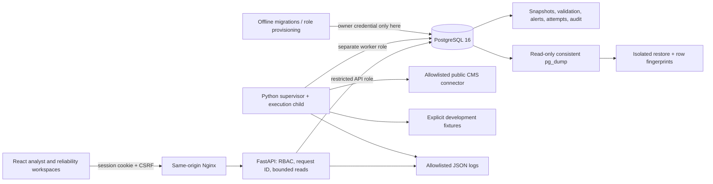

# CareRank 6.0 operational architecture

The existing PostgreSQL queue remains the source of truth. Workers claim with row locking/`SKIP LOCKED`, a one-running-execution-per-pipeline constraint, durable leases and frozen retry policies. Publication checks the live lease inside the transaction. A worker can repeat a fetch after failure; deterministic content identity and a durable publication checkpoint prevent duplicate published content. Monitoring resumes against that checkpoint. This is **at-least-once execution with idempotent publication**, not exactly once.

Migration 007 adds transient presence and indexes, without rewriting the 22 pre-existing data tables. Worker heartbeats use database time; readiness requires an idle/running pulse within 30 seconds for that instance. API readiness checks database access and migration 007, while liveness is independent of PostgreSQL. Readiness is not a guarantee that CMS is reachable or every dependency is healthy. Docker marks unhealthy containers but does not automatically restart them solely for failed health checks; operators must inspect/replace stalled workers.

`GET /api/operations/reliability?hours=24` requires a session and is read-only. The window is bounded to 1–168 hours. Success rate is succeeded / (succeeded + failed + timed_out), excluding cancellation. Durations span first attempt to final completion, including retry waits; never-started cancellations have no duration. Retry counts use attempt start time; completion counts use finish time. Queue/worker/alert counts describe current state, not historical window totals. SQL aggregates avoid returning entire histories; separate READ COMMITTED queries may observe slightly different concurrent states.

UUID request IDs propagate to structured HTTP logs and manual pipeline audit events; worker logs carry execution/attempt IDs. Application logs omit arbitrary messages, bodies, headers, query strings, SQL parameters and exception text. UUIDs are correlation hints, not authentication or proof of uniqueness. Database connects/pool waits are bounded to five seconds and statements default to 30 seconds. Existing worker publication lock timeouts and fencing remain in place.

Security boundaries retained: Argon2 passwords, hashed opaque sessions, expiration/logout, HttpOnly/SameSite cookies, origin + token CSRF checks, backend role checks, revision conflicts, append-only audit triggers and distinct owner/API/worker database privileges. The API can only read worker presence; workers cannot administer accounts or synthetic scores. Mounted `*_FILE` secrets conflict with direct values rather than silently overriding them. Production containers mount only their own runtime credential; migration credentials are operator-only.

The AWS reference is ALB HTTPS → one SSM-managed EC2 Docker host → private encrypted PostgreSQL RDS, with Secrets Manager and CloudWatch. It avoids NAT/Kubernetes/extra queues. It deliberately has a single application host; Multi-AZ RDS alone does not provide application HA. See [cloud runbook](../infra/README.md) for approval gates, trust boundaries and residual risks, and [measured evidence](RELEASE_6.0.md) for actual scope.
