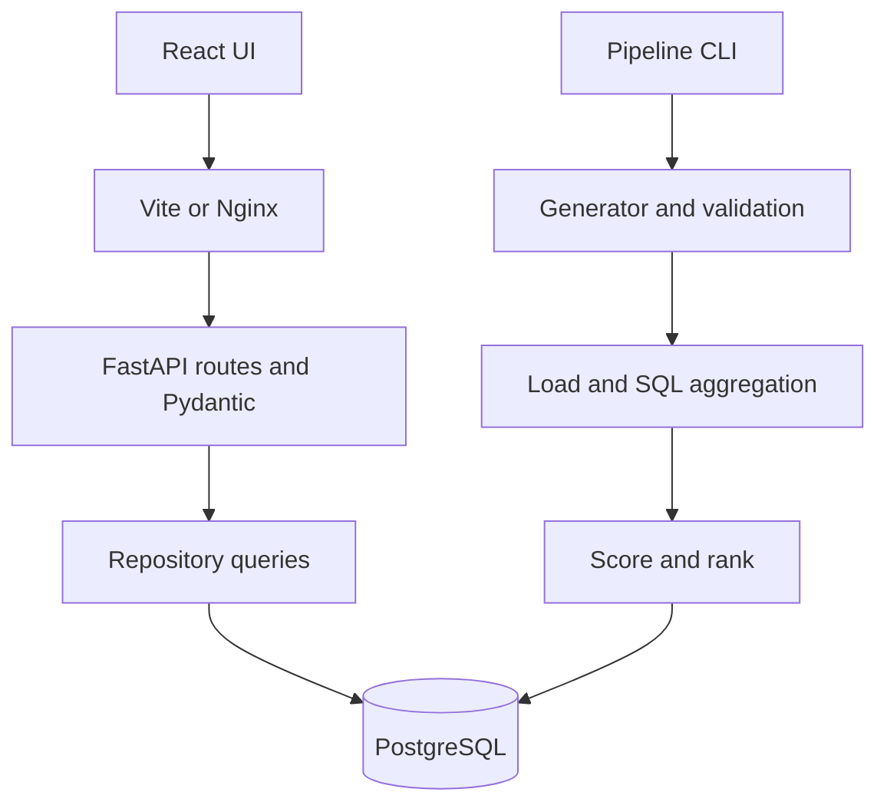
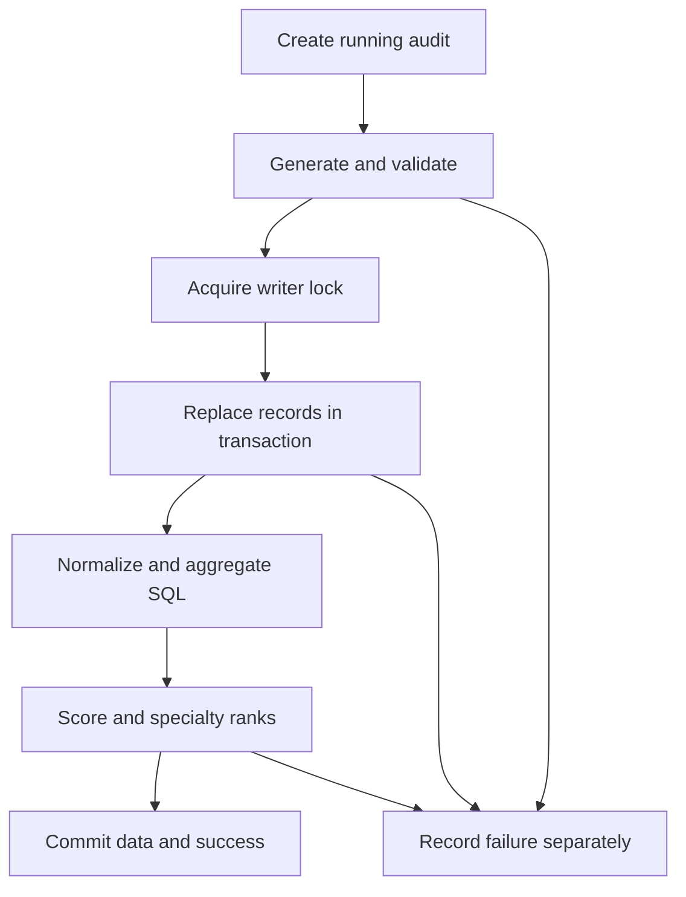

# CareRank Lab Complete Technical Guide

Prepared for Prabhat Mattaparthi. This guide explains the implemented repository so you can trace requests, change behavior and defend design choices in an engineering interview. Start by running the app and completing an exercise. The system demonstrates software engineering with fictional healthcare data; it has no validated clinical meaning.

## Chapter 1 Project purpose

Provider intelligence connects several engineering problems: collecting records, rejecting unreliable inputs, defining comparable cohorts, calculating interpretable metrics, and presenting results without hiding uncertainty. CareRank Lab implements that chain on a bounded synthetic dataset. Its product question is: how can a user inspect a provider's simulated outcomes, costs and supporting evidence, then compare that provider with similar specialists?

Garner's role description supplied the motivation: provider analytics, healthcare software and member-facing decisions. This project relates to those engineering concerns. It does not use Garner data, emulate its clinical metrics, claim access to its internal architecture, or establish healthcare savings. The useful portfolio evidence is the functioning software, the tests and your ability to explain the implementation.

The generator creates 1,000 fictional providers and 100,000 encounters by default. Five specialties and five cities support filters. Events have a procedure category, synthetic risk, cost and an optional binary outcome. There are no patient identifiers, real provider names, insurance claims or confidential employer inputs. Costs are simulated dollar amounts rather than prices for real services.

The biggest limitation is also intentional: the risk model and outcome mechanism are invented. The model knows the generator's baseline. This makes the mechanics teachable but does not test whether a model generalizes to real clinical data. Provider selection, missingness, patient severity and treatment effectiveness are far more complex in actual healthcare.

## Chapter 2 Technology stack

Python 3.12 runs generation, validation, scoring, API handlers and tests. Its role is orchestration and business logic. TypeScript checks frontend data shapes at build time; it does not validate JSON at runtime. React renders views as functions of state, including selected providers and search filters. Vite resolves modules, serves development assets, proxies API calls and builds static production files. Native form controls and custom CSS provide the interface without a large component framework. Lucide supplies icons; CSS bars provide simple distributions without a chart dependency.

FastAPI maps HTTP requests to Python functions, validates query parameters and publishes OpenAPI. Pydantic models define explicit batch and response contracts. SQLAlchemy builds parameterized queries, maps tables to Python classes and pools connections. Psycopg is the PostgreSQL driver beneath SQLAlchemy. PostgreSQL stores records, enforces keys and checks, computes set-based aggregates and supplies transaction isolation. Alembic versions schema changes so a fresh database can reproduce the schema.

Docker describes reproducible service images; Compose coordinates PostgreSQL, migrations, seed execution, API and web startup. Nginx serves production assets and forwards /api to FastAPI. Development uses Vite as the corresponding proxy. The browser therefore calls the same origin and never receives database credentials. Make groups routine commands. Git tracks local changes; GitHub Actions defines remote validation after publication.

Pytest covers backend functions and PostgreSQL integration. Vitest and Testing Library exercise React behavior in a simulated DOM. A live Vitest workflow uses real HTTP through Vite and FastAPI into PostgreSQL. Playwright defines a separate real-browser workflow, which also captures screenshots when Chromium can start. These are complementary checks: a DOM test cannot establish visual correctness. Ruff checks Python and formats code; Prettier formats frontend source. Python-docx and the document renderer generated these learning artifacts; they are documentation tools, not runtime services.

Reasonable alternatives include Flask or Django instead of FastAPI, raw psycopg instead of SQLAlchemy, Next.js instead of Vite, and a task scheduler instead of a CLI. Each brings tradeoffs. This project has no server-side rendering or SEO requirement, so a browser SPA is sufficient. PostgreSQL was retained instead of SQLite because SQL behavior, migrations and concurrency are central learning objectives.

Direct Python package versions are pinned in backend/requirements.txt. Frontend package-lock.json records the complete resolved npm graph; use npm ci. The runtime versions were checked by installation, type checking and tests rather than assumed from a code sample. Python transitive dependencies are not fully locked, and container tags are not digest-pinned; production reproducibility would tighten those controls.

## Chapter 3 System architecture

The API reads precomputed scores; it does not recompute all encounter aggregates for every search. The CLI pipeline is the only application entry point that replaces the dataset. This separates expensive write work from frequent read work without requiring separate deployments or a queue.

The relationship is Provider one-to-many Encounter, and Provider one-to-one Score. PipelineRun is an independent audit table. It records parameters and timing but has no foreign key to a dataset version because the demo keeps only the current dataset. If versioned clinical analytics were needed, a dataset_id would belong on records and scores, and audits would link to that immutable snapshot.

Provider has an integer primary key, synthetic display name, specialty and location. Encounter has an integer primary key and provider foreign key, plus procedure, risk, cost and nullable outcome. Score uses provider_id as its primary key, enforcing at most one score per provider. It stores counts, mean raw cost, nullable quality and rank, and a JSON explanation. PipelineRun uses a UUID string primary key and UTC timestamps. Indexes support category filtering and joins; substring name search is adequate at 1,000 rows but is not a full-text search solution.

HTTP flow: Explorer changes a filter, URLSearchParams encodes it, useApi fetches /api/providers, Vite or Nginx proxies it to FastAPI, the route validates values, repository.search builds bound SQL, and Pydantic serializes the result. React renders the response or an explicit loading, empty or error state. AbortController cancels stale requests when filters change. Pagination resets on filter changes. Comparison rejects mixed specialties in both the UI and API.

A request session uses REPEATABLE READ so the page count and result list share one database snapshot during a refresh. The pipeline uses the engine's default READ COMMITTED isolation and a transaction-scoped advisory lock to serialize dataset writers. Deletes, inserts, aggregate calculation, score writes and success audit update commit together. PostgreSQL readers see committed data, not a half-loaded dataset. The initial running audit is committed separately, so an ordinary failure remains visible even if the dataset transaction rolls back.

## Chapter 4 Code and functions

Read the code in this order: generator.py, validation.py, aggregate.sql, scoring.py, pipeline.py, repository.py, main.py, then App.tsx. The generated function catalog later in this chapter is an exact signature inventory of project Python functions and classes. Frontend components and routes are described separately because their purpose is easiest to follow as a request and interaction flow.

### Data generation and validation

`generate(providers, encounters, seed)` uses a local random.Random object. A private generator avoids unrelated code changing a global seed. It assigns specialties deterministically, chooses locations and draws provider skill and efficiency factors. Every seventeenth provider receives lower sampling weight, creating realistic teaching examples of insufficient evidence. The returned provider and encounter lists are bounded to demo sizes to limit accidental memory use. The complete batch is held in memory; streaming is a future extension.

Risk follows a beta distribution. A procedure multiplier, risk multiplier, provider efficiency and small noise determine cost. Outcomes are Bernoulli draws around expected_success(risk) plus a synthetic provider effect. Approximately 2.5% of outcome values are missing. They are retained as NULL and reduce completeness; they are not converted to failures or successful outcomes.

`validate` applies strict Pydantic input models, checks allowed specialties and locations, tracks IDs in sets to detect duplicates, and checks that every encounter references an input provider. Validation happens before any dataset write. It returns counts and missing-outcome information. A missing required field, invalid numeric value, infinity, duplicate ID or unknown provider raises an exception. Python sets give expected linear-time duplicate checking; they also consume memory proportional to input size.

### Pipeline and scoring responsibilities

`run_pipeline` creates a running audit, generates or accepts test fixture records, validates them, then opens the data transaction. It uses batches of 5,000 for encounter inserts to avoid one enormous statement. It executes the static aggregation SQL, passes each result into score_provider, computes ranks within specialties, writes scores and marks success. It returns the audit UUID, not the dataset itself. Tests inject a source batch and an engine to make invalid-input and rollback cases deterministic.

Scoring functions are independent of the database. This is why their boundary behavior can be tested quickly without a server. rank_specialties mutates row dictionaries with competition ranks: two tied first-place scores are followed by rank 3. Sorting by provider ID makes output deterministic, but does not break a score tie into different clinical ranks. Providers with null quality retain null rank.

### Queries and routes

repository.provider_query produces one joined Provider/Score query. serialize maps those records to the public shape. search applies filters before computing total, escapes literal substring wildcard characters, then uses a fixed sort allowlist and ID tie-breaker. A page contains at most 100 records; the UI requests 12. Null scores sort last. Filtering by minimum quality excludes nulls by SQL semantics. Cost filtering uses average raw encounter dollars, while the cost score uses normalized specialty-relative costs; do not confuse the two.

get_provider returns a profile or None, which the route converts to HTTP 404. runs returns the newest 20 attempts. analytics counts records, computes a mean over non-null scores, builds a five-bin score distribution and returns both the most recent attempt and last successful refresh. This distinction prevents a failed attempt from being mistaken for new data.

The API routes are GET /api/health, /api/providers, /api/providers/{provider_id}, /api/compare, /api/analytics and /api/pipeline. OpenAPI is at /openapi.json and interactive documentation at /docs. Compare accepts repeated ids parameters, two or three unique IDs, and a single specialty. API response models are ProviderPage, ProviderView, Analytics and RunView; Components and Bucket are nested contracts. Unexpected database errors return a sanitized 503 response.

### Frontend inventory

App owns the selected page and provider IDs. Overview fetches Analytics and renders metric cards, distributions and pipeline freshness. Explorer owns filter, sort, page and comparison state; its change helper resets pagination, and select prevents mixed-specialty or oversized selections. Details chooses a detail or comparison endpoint and renders evidence and score components. ScoreBadge distinguishes null evidence from a numeric score. State renders errors/loading/empty states. Bars renders a labeled horizontal distribution. num and money format numbers for display. useApi manages asynchronous request state and cancellation. main.tsx mounts App in React StrictMode. types.ts declares the expected API shapes.

All frontend functions are in src/App.tsx except useApi in src/api.ts. Component tests live in App.test.tsx; the actual HTTP-backed interaction test is Live.test.tsx. Playwright's workflow.spec.ts covers navigation, specialty filtering, pagination, comparison, profile, screenshots and mobile overflow on a machine where Chromium can launch. Vite configuration supplies the API proxy and Vitest environment; Playwright configuration supplies the base URL and optional executable path.

### Exact Python signature inventory

The following catalog is generated from Python AST nodes in the delivered repository. Validation schema classes and database model classes have declarative fields rather than custom constructors. Each file's call relationships and testing role are described alongside the catalog entries. Test functions themselves document verification behavior; framework fixtures call them, rather than application code.

### backend/app/benchmark.py

CLI entry point; replaces demo data, performs warmups, times search and prints JSON. Executed for docs/benchmark.json; not a separate unit test.

- `main()` — Implementation follows the module responsibility above; inspect this named function for its assertions or route mapping.

### backend/app/db.py

Used by routes, pipeline, benchmark and Alembic. Settings reads environment; engine is cached; session generator controls cleanup and read isolation. Connection behavior is exercised by PostgreSQL integration and live UI checks.

- `class Settings` — Read database configuration from environment; no credential defaults.

- `get_engine()` — Build one pooled SQLAlchemy engine per process.

- `get_session()` — Close each request's database session even if a request fails.

### backend/app/generator.py

Called by run_pipeline and generator tests. Returns deterministic lists; reproducibility and invalid-size behavior are testable without PostgreSQL.

- `expected_success(risk: float) -> float` — Known synthetic expectation, deliberately not a fitted clinical model.

- `generate(providers: int=1000, encounters: int=100000, seed: int=42)` — Return provider/event dictionaries with stable IDs and a private random generator.

### backend/app/main.py

Invoked by FastAPI routing or exception handling. Inputs are validated query/path values and a request session. Returns typed JSON or appropriate HTTP errors; covered by integration routes tests.

- `async database_error(request: Request, error: SQLAlchemyError)` — Return a safe service error without exposing credentials or query internals.

- `health(db: DB) -> dict[str, str]` — Implementation follows the module responsibility above; inspect this named function for its assertions or route mapping.

- `providers(db: DB, q: str=Query('', max_length=100), specialty: str | None=None, location: str | None=None, min_quality: float | None=Query(None, ge=0, le=100), max_cost: float | None=Query(None, gt=0), page: int=Query(1, ge=1), page_size: int=Query(20, ge=1, le=100), sort: Literal['quality', 'cost']='quality')` — Implementation follows the module responsibility above; inspect this named function for its assertions or route mapping.

- `compare(db: DB, ids: Annotated[list[int], Query(min_length=2, max_length=3)])` — Implementation follows the module responsibility above; inspect this named function for its assertions or route mapping.

- `detail(provider_id: int, db: DB)` — Implementation follows the module responsibility above; inspect this named function for its assertions or route mapping.

- `analytics(db: DB)` — Implementation follows the module responsibility above; inspect this named function for its assertions or route mapping.

- `pipeline_status(db: DB)` — Implementation follows the module responsibility above; inspect this named function for its assertions or route mapping.

### backend/app/models.py

Used by SQLAlchemy and repository/pipeline queries. Fields define table mapping, keys and checks. Migration and persistence behavior is exercised by integration tests.

- `class Base` — Shared SQLAlchemy schema registry.

- `class Provider` — Fictional provider identity; one specialty and location per provider.

- `class Encounter` — Synthetic events, without patient identifiers; nullable outcomes are intentional.

- `class Score` — One materialized score per provider in the current dataset.

- `class PipelineRun` — Durable execution audit independent of dataset replacement.

### backend/app/pipeline.py

Called by CLI, integration fixtures and benchmark. Returns a run UUID; transaction, rerun and exception behavior are covered in test_integration.py.

- `run_pipeline(providers: int=1000, encounters: int=100000, seed: int=42, engine=None, source=None) -> str` — Audit separately, serialize writers, and replace data+scores in one transaction.

- `main()` — Expose reproducible dataset size and seed as CLI flags.

### backend/app/repository.py

Called by API routes; search is also called by benchmark. Returns response dictionaries/records. Filter, count, ordering and aggregation behavior is tested through the API.

- `provider_query()` — Join identity and materialized performance; no N+1 loading.

- `serialize(provider, score) -> dict` — Map database records to the explicit public response shape.

- `search(session: Session, q: str, specialty: str | None, location: str | None, min_quality: float | None, max_cost: float | None, page: int, page_size: int, sort: str) -> dict` — Bind filters, count matches, and apply stable ordering and bounded pagination.

- `get_provider(session: Session, provider_id: int) -> dict | None` — Return a single profile, or None for a nonexistent identifier.

- `runs(session: Session) -> list` — Return the 20 newest execution audit rows.

- `analytics(session: Session) -> dict` — Aggregate dashboard facts, excluding null scores from the histogram and mean.

### backend/app/schemas.py

Used as FastAPI response contracts. Fields define JSON inputs/outputs and validation; route integration tests exercise serialization.

- `class Components` — Declarative fields define the schema described above.

- `class ProviderView` — Declarative fields define the schema described above.

- `class ProviderPage` — Declarative fields define the schema described above.

- `class RunView` — Declarative fields define the schema described above.

- `class Bucket` — Declarative fields define the schema described above.

- `class Analytics` — Declarative fields define the schema described above.

### backend/app/scoring.py

Called by run_pipeline after SQL aggregation. Pure functions are exercised by score boundary, direction, worked-example, tie and invalid-value tests.

- `clamp(value: float) -> float` — Bound a component to the display range [0,100].

- `score_provider(total: int, observed: int, residual: float, cost_ratio: float) -> dict` — Shrink toward neutral using observed/(observed+50); suppress weak evidence.

- `rank_specialties(rows: list[dict]) -> list[dict]` — Mutate rows with competition ranks by specialty; tied rounded scores share rank.

### backend/app/validation.py

Called before writes by run_pipeline. Input model validation and duplicate/orphan checks are exercised in test_scoring.py and failure integration tests.

- `class ProviderInput` — Strict incoming provider schema.

- `class EncounterInput` — Strict incoming event schema; only outcomes may be missing.

- `validate(providers: list[dict], encounters: list[dict]) -> dict` — Reject invalid batches; report missing outcomes without silently imputing them.

### backend/migrations/versions/001_initial.py

Alembic invokes upgrade/downgrade. Initial schema is frozen here instead of importing evolving app metadata. Upgrade was exercised; downgrade verification is recorded in the report.

- `class Base` — Shared SQLAlchemy schema registry.

- `class Provider` — Fictional provider identity; one specialty and location per provider.

- `class Encounter` — Synthetic events, without patient identifiers; nullable outcomes are intentional.

- `class Score` — One materialized score per provider in the current dataset.

- `class PipelineRun` — Durable execution audit independent of dataset replacement.

- `upgrade()` — Implementation follows the module responsibility above; inspect this named function for its assertions or route mapping.

- `downgrade()` — Implementation follows the module responsibility above; inspect this named function for its assertions or route mapping.

### backend/tests/test_integration.py

Pytest invokes test cases and fixtures. Inputs are fixtures/parameters; assertions specify expected behavior. These functions are not production entry points.

- `engine()` — Implementation follows the module responsibility above; inspect this named function for its assertions or route mapping.

- `client(engine)` — Implementation follows the module responsibility above; inspect this named function for its assertions or route mapping.

- `test_counts_and_rerun(engine)` — Implementation follows the module responsibility above; inspect this named function for its assertions or route mapping.

- `test_failed_validation_preserves_data(engine)` — Implementation follows the module responsibility above; inspect this named function for its assertions or route mapping.

- `test_mid_transaction_failure_rolls_back(engine, monkeypatch)` — Implementation follows the module responsibility above; inspect this named function for its assertions or route mapping.

- `test_sql_case_mix_and_nulls(engine)` — Implementation follows the module responsibility above; inspect this named function for its assertions or route mapping.

- `test_api_search_and_pagination(client)` — Implementation follows the module responsibility above; inspect this named function for its assertions or route mapping.

- `test_invalid_query(client, query)` — Implementation follows the module responsibility above; inspect this named function for its assertions or route mapping.

- `test_comparison_and_details(client)` — Implementation follows the module responsibility above; inspect this named function for its assertions or route mapping.

- `test_analytics_and_openapi(client)` — Implementation follows the module responsibility above; inspect this named function for its assertions or route mapping.

- `test_zero_events_and_case_mix(engine)` — Implementation follows the module responsibility above; inspect this named function for its assertions or route mapping.

- `session()` — Implementation follows the module responsibility above; inspect this named function for its assertions or route mapping.

- `fail(*args)` — Implementation follows the module responsibility above; inspect this named function for its assertions or route mapping.

### backend/tests/test_scoring.py

Pytest invokes test cases and fixtures. Inputs are fixtures/parameters; assertions specify expected behavior. These functions are not production entry points.

- `test_reproducible()` — Implementation follows the module responsibility above; inspect this named function for its assertions or route mapping.

- `test_insufficient(total, observed)` — Implementation follows the module responsibility above; inspect this named function for its assertions or route mapping.

- `test_thresholds_and_direction()` — Implementation follows the module responsibility above; inspect this named function for its assertions or route mapping.

- `test_worked_example()` — Implementation follows the module responsibility above; inspect this named function for its assertions or route mapping.

- `test_invalid_aggregates(args)` — Implementation follows the module responsibility above; inspect this named function for its assertions or route mapping.

- `test_bounds()` — Implementation follows the module responsibility above; inspect this named function for its assertions or route mapping.

- `test_specialty_ranking_and_ties()` — Implementation follows the module responsibility above; inspect this named function for its assertions or route mapping.

- `test_bad_batches(defect)` — Implementation follows the module responsibility above; inspect this named function for its assertions or route mapping.

- `test_missing_outcome_allowed()` — Implementation follows the module responsibility above; inspect this named function for its assertions or route mapping.

### scripts/setup_env.py

Invoked by make setup. Writes a random local-only password without overwriting an existing .env; never prints the password.

- `main()` — Implementation follows the module responsibility above; inspect this named function for its assertions or route mapping.

## Chapter 5 Algorithms and SQL

Let N be all encounters and n the observed outcomes for a provider. For each observed event, expected success is 0.95 minus 0.30 times risk. Residual is actual binary outcome minus this expectation. The provider's residual d is the mean over observed outcomes only. A positive residual means the simulated outcomes exceeded the generator baseline; it is not proof of superior care.

Shrinkage weight w = n / (n + 50). Outcome component O = clamp(50 + 250 × d × w). This moves unstable small samples toward 50. It is a heuristic inspired by shrinkage, not a fitted Bayesian model or a confidence interval. The multiplier 250 is a teaching scale choice. A provider with no observed outcomes gets a neutral internal outcome component but no overall score.

Cost is divided by procedure multiplier and (1 + risk). The SQL procedure multipliers match the generator: Consultation 1.0, Diagnostic 1.7, Follow-up 0.65. The normalized event cost is compared with the mean normalized event cost of the same specialty. This benchmark is encounter-weighted, includes the provider itself and includes events whose outcomes are missing. Let c be the provider mean ratio. Cost component C = clamp(50 + 50 × (1 − c) × w). Lower relative cost improves this component; it never establishes whether treatment was appropriate.

Reliability R = 100 × (n/N) × w, with completeness zero if N is zero. Volume V = 100 × min(N/200, 1). Overall score Q = 0.60 O + 0.25 C + 0.10 R + 0.05 V, rounded to two decimals. Q is returned only when n is at least 30 and completeness is at least 0.80. Those cutoffs and weights are explicit policy choices, not empirically validated thresholds. Including volume in the final score can favor larger practices; that is a tradeoff to discuss, not a medical claim.

Worked example: N = n = 100, d = 0.04 and c = 0.80. Then w = 2/3, O = 56.6667, C = 56.6667, R = 66.6667 and V = 50. The weighted result is 57.3333, stored as 57.33. The UI displays 57.3 but ranking uses the stored two-decimal value. If n were 29, Q and rank would be null regardless of an attractive outcome or cost component. If N=100 and n=79, low completeness also suppresses Q.

aggregate.sql uses two common table expressions. normalized computes per-event cost adjustment and residual; benchmarks computes one specialty average. The final SELECT starts from providers and LEFT JOINs events, preserving providers with zero encounters. COUNT(n.id) counts actual joined events, whereas COUNT(n.outcome) counts only non-null outcomes. AVG ignores NULL outcomes. COALESCE supplies neutral numeric inputs for empty cohorts; eligibility still prevents false rankings.

Filtering is a database operation before LIMIT/OFFSET. Filtering after pagination would give incorrect totals and underfilled pages. Stable ID ordering matters when scores tie. Offset pagination is easy for 1,000 providers; keyset pagination is a sensible later optimization for large or frequently changing cohorts. The search benchmark measures both the count and page query, not merely Python filtering.

## Chapter 6 Security testing and reliability

The security boundary is a local educational workspace. Credentials are environment variables; setup_env.py writes a random password to an ignored file with restrictive permissions. Compose does not publish PostgreSQL externally and binds web/API ports to loopback. React escapes text; the application does not render raw user HTML. ORM parameters avoid concatenating search input into SQL. Nginx adds basic content, framing and resource-policy headers. These controls do not replace authentication or clinical governance.

The API is read-only, but its database account is shared with the pipeline in the simple Compose setup. Production requires separate roles, least-privilege grants, authentication, authorization, TLS, rate limiting, secret rotation, monitoring and backup tests. No HIPAA or other compliance certification is claimed. Dependency pins improve repeatability; an automated vulnerability audit was not performed.

Tests cover reproducibility, bounds, insufficient data, score direction, ties, invalid aggregates, duplicate records, missing fields, orphan references, null outcomes, PostgreSQL migrations, rerun counts, validation failures, mid-transaction failure rollback, SQL residuals, search escaping, filters, sorting, pagination, comparison rules and analytics. Frontend tests verify score labels, errors, disclaimer and navigation. The live DOM workflow verifies real component interactions across HTTP into the seeded database.

Measured on the build environment with Python 3.12.14 and PostgreSQL 16.2: the full 1,000-provider, 100,000-encounter pipeline took 3.869 seconds. After five warmups, 100 Cardiology searches had a median of 1.772 ms and p95 of 2.475 ms. These timings include database count, page retrieval and serialization but exclude HTTP and rendering. They are single-environment measurements, not production guarantees.

The verification report is the authoritative record of execution. Browser testing was attempted but blocked by the environment's Unix-socket restriction; that does not establish browser behavior or visual correctness. Docker is not installed in this build environment. Compose files and CI are provided, but startup must still be verified on a machine with Docker. Passing unit tests is not permission to describe those unexecuted checks as passing.

Failure behavior: invalid input leaves the previous dataset untouched. A scoring exception inside the write transaction rolls back all replacement work. The separately committed audit records the exception class. A process kill or complete database outage may prevent final audit updates, leaving status running. Automatic retry, timeout recovery and orphan-run reconciliation are future work. Reruns replace the snapshot rather than accumulating duplicates; they do intentionally add new audit entries.

## Chapter 7 Engineering decisions

A modular monolith is enough for this scope: one frontend, one API and one CLI using shared Python domain code. Microservices would introduce network contracts and deployment concerns without improving the learning objective. Synchronous SQLAlchemy is appropriate because request work is ordinary database I/O and the demo does not claim massive concurrency. Async conversion would require measurement and careful driver/session changes.

Stored provider scores make reads predictable but add freshness management. The UI therefore exposes last successful refresh and latest attempt separately. Atomic full replacement simplifies correctness and reruns but produces write amplification and discards history. At larger scale, immutable dataset versions or incremental merge operations would be preferable.

No dbt was used because one short SQL aggregation file does not need a separate model graph and execution layer. No Airflow was used because there is one CLI pipeline rather than a scheduled multi-team DAG. No dlt was used because the input is generated locally rather than extracted from external sources. AWS and Kubernetes were excluded because cloud deployment and orchestration are not needed to demonstrate the requested competencies at this size. These are scope choices, not claims that the technologies lack value.

The UI uses standard labeled controls and semantic tables. This reduces dependencies and makes keyboard operation easier to reason about. The page navigation is local React state, so there are no bookmarkable profile routes and a refresh returns to Overview. That is an explicit mini-project tradeoff; a router is a reasonable next enhancement. Form validation comes from numeric controls plus API validation, not a separate form library.

## Chapter 8 Actual AI development process

Prabhat supplied the product scope, stack, ethical data restrictions, desired deliverables and learning goals. ChatGPT generated the code, schemas, frontend, tests, infrastructure and documentation. The first workspace became unavailable before verification. The restored Linux workspace had no transferred project files, so the implementation was recreated there from the established design.

ChatGPT used shell execution, Python, npm, Ruff, TypeScript, pytest, Vitest and PostgreSQL binaries packaged for local development. Official documentation was consulted for FastAPI response validation, SQLAlchemy PostgreSQL drivers, Vite runtime requirements and Compose dependency ordering. The build did not use GitHub Copilot, Cursor, Claude, dbt, Airflow, AWS or Kubernetes. No GitHub repository was created or pushed, and no remote GitHub Actions run occurred.

Verification included actual PostgreSQL migrations, generation and processing of the full dataset, measured search timings, backend tests, frontend tests, a production build and a live React-to-API workflow. Errors found and corrected included a worked-example test's arithmetic, TypeScript test typing, Python import placement and environment-specific Vite startup binding. A repeatable-read request session was added to avoid inconsistent multi-query read snapshots during refresh.

Tests were also AI-authored, so passing them is execution evidence, not an independent human audit. No separate reviewer or human code contribution is invented. Prabhat has not yet been observed completing the learning exercises. Before claiming personal mastery, reproduce the checks, trace a request, make a change and explain the resulting diff. Keep a personal learning log with those concrete contributions.

## Chapter 9 Garner business value

The project connects a data foundation to a usable software product. A provider analytics team needs trustworthy transformations, comparable cohorts, useful APIs, understandable interfaces and failure visibility. CareRank Lab demonstrates these engineering boundaries in a small codebase an associate engineer can study end to end.

The relevance is architectural and educational. Transparent score components help communicate how a result was formed. Data-quality handling avoids pretending missing outcomes are valid evidence. Specialty-specific comparisons prevent an obvious apples-to-oranges ranking mistake. API validation, transaction rollback and test coverage demonstrate care in software construction. None of these facts proves that the simulated rankings improve real patient outcomes or reduce healthcare spending.

In an interview, tie the demo to responsibilities you could contribute to: implementing a validated endpoint, maintaining an ingestion job, writing an integration test, investigating a database issue or improving a loading/error state. Ask how the actual team governs clinical metrics, tests data changes and handles versioned provider evidence. Do not assume their internal system resembles this project's schema.

## Chapter 10 Future improvements

For larger datasets, stream input batches, use PostgreSQL COPY where measured useful, partition encounter history, maintain incremental aggregates and benchmark query plans with EXPLAIN ANALYZE. Keep score versions and immutable dataset IDs. Separate API reader and pipeline writer roles. Introduce cursor pagination only when offset cost is demonstrated.

For production, add identity, authorization, HTTPS, managed secrets, least-privilege database grants, audit access, backups, recovery drills, request limits, structured tracing and pipeline alerts. Add stale-run recovery and retry policies that distinguish transient connectivity failures from invalid input. Container scanning and fully locked dependencies would strengthen supply-chain practices.

For real clinical analytics, obtain authorized and governed data, define outcomes with clinical experts, validate risk models on held-out populations, quantify uncertainty, investigate missingness and selection bias, audit fairness, and establish monitoring for drift. Prospective evaluation and causal methods may be necessary before making improvement claims. A heuristic score cannot substitute for that process.

For your learning, implement the five exercises in order. Finish by drawing the request path without looking at the guide, explaining the worked example by hand, injecting a pipeline failure, and tracing a score back to its SQL inputs. That demonstration is stronger interview evidence than memorizing a polished pitch.

## Official references checked during implementation

- FastAPI response models: https://fastapi.tiangolo.com/tutorial/response-model/
- SQLAlchemy PostgreSQL dialect: https://docs.sqlalchemy.org/en/21/dialects/postgresql.html
- Vite setup and runtime requirements: https://vite.dev/guide/
- Compose startup ordering: https://docs.docker.com/compose/how-tos/startup-order/

Read the repository lockfiles for the exact selected versions. Documentation changes over time; these references were consulted on November 14, 2026.
